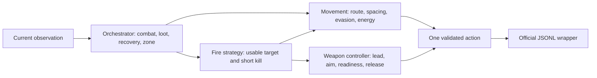

# Aggressive kill-oriented strategy — target 6.0

The user's updated objective is greedy, aggressive play with as many kills as
possible. It supersedes waiting for external fights, requiring attackers to
shoot first, and protecting quiet enemy mechs from collateral damage.

The official practice score is mean `16 - place` across 48 matches; kills are
not direct points. Aggression should remove opponents and collect their resources
while retaining enough health, energy and zone access to keep fighting. The
historical best measured entry scored 4.75. The acceptance target remains 6.0.

The agent names describe development responsibilities and deterministic runtime
controllers. The submitted bot is one standard-library Python process with no
network or model calls during matches.

## Fire strategy agent

Follow [FIRE_STRATEGY_PLAN.md](FIRE_STRATEGY_PLAN.md): proactively target current
visible enemies, prioritize physically feasible short kills, then use the
measured best entry's target-value ranking and stable focus. Preserve verified
ballistics, readiness, body interception, laser release and shared-aim scheduling.
All current hostile mechs are eligible for damage. Unknown or hidden positions
are not firing targets. A missing short-kill estimate does not make a full-health
enemy ineligible for ordinary combat.

## Movement strategy agent

Restore useful approach and pursuit instead of the universal no-approach clamp.
The detailed design is in [MOVEMENT_STRATEGY_PLAN.md](MOVEMENT_STRATEGY_PLAN.md).
Start with the best entry's gun/laser spacing and the verified favorable
lightning-entry conditions. Keep collision-aware routing, urgent zone progress,
projectile avoidance, and sustained boost/recharge management. The separately
reproduced short recovery escape may help regain a useful fighting position.
Shorter spacing remains a later measured experiment.

## Orchestration strategy agent

Follow [ORCHESTRATION_STRATEGY_PLAN.md](ORCHESTRATION_STRATEGY_PLAN.md). Use rotation, lethal opportunity, useful combat, valuable resources and recovery
as explicit competing priorities. Do not replace an available kill with a crate
farm. Permit useful close pickups while firing, and grow the build when no useful
combat is available. Recovery is a way to return to combat: keep firing when a
short kill is available or active pressure prevents quiet healing; otherwise
take a real repair window. The orchestration tests now cover proactive attacks,
pursuit, interception, economy, recovery, reloads, energy, rotation and laser
release; selective-only root expectations have been replaced.

Initial implementation keeps the measured HP recovery hysteresis. During
recovery it permits a verified short kill within 1.25 seconds while above 15%
HP, current nearby pressure within 28 metres, or recently received weapon
damage within the shorter of three seconds and the live regeneration delay.
Otherwise it stops dealing damage long enough to heal. These are explicit
strategy settings, not guarantees about future incoming damage.

The first live trace exposed an integration conflict: recovery permitted a short
kill, but Combat's emergency flag still prevented every fresh laser charge.
The correction identifies the weapon supporting the short estimate. A grounded,
non-urgent recovering bot above 15% HP may begin a laser charge only when that
laser itself has a verified finishing ETA within 1.25 seconds and firing is
currently permitted. Urgent rotation and airborne recovery retain the charge
veto. Charging still slows movement; this exception is a tactical tradeoff,
not a prediction that incoming attacks will miss.

A short kill takes priority over resource detours. Other safe loose cubes and
weapons can be collected while firing at range. Farming loses priority to a
close mech exchange; a nearby attacking NPC can be cleared before a distant
full-health mech when no close mech or validated short kill takes precedence.

## Implementation and evaluation sequence

1. Preserve prior submitted source `01df3dc` and its selective result: BB-AC10AB33
   scored 2.69. Historical best remains `39b6d50`, 4.75.
2. Implement the proactive selector, root priorities and approach policy while
   preserving tested mechanical fixes.
3. Verify proactive full-health attacks, feasible kill selection, focus stability,
   hostile collateral, recovery tradeoffs, resources and zone/collision behavior.
4. Run the complete regression suite, dense real-map timing, restricted Docker
   checker and a frozen private diagnostic. Report commands separately from hits.
5. Publish the exact validated commit and evaluate it through official scoring.
   Keep the best measured entry; do not infer practice strength from private wins.

BB-AC10AB33 scored 2.69 using the previous selective policy. That result cannot
be attributed to this new aggressive candidate, and the historical best remains 4.75.
