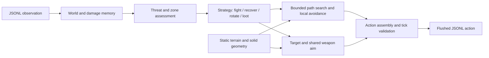

# Mech Royale program design and competition plan

Prepared November 21, 2026 for team **labubu**. Requirements below were checked
against the official event page, track page, full protocol, and downloaded kit.
Strategy recommendations are hypotheses to evaluate, not a promised winning score.

The current user-confirmed aggressive, kill-oriented strategy and 6.0 official
score objective are in [AGGRESSIVE_PLAN.md](AGGRESSIVE_PLAN.md). This document
retains the original requirements and development plan; the former selective
policy in [AGENT_STRATEGY_PLAN.md](AGENT_STRATEGY_PLAN.md) is historical.

## 1. Objective and requirements

The objective is to maximize mean `16 - placement`, between 0 and 15. Kills give
resources but no direct score. Simultaneous deaths share placement; surviving
mechs are ordered by HP if time expires.

| Requirement | Verified rule |
|---|---|
| Eligibility | Current students at any school/country, school-email registration |
| Team | One or two people; each person belongs to one team |
| Remote entry | Fully remote participation and winning are permitted |
| Deadline | November 22, 2026, 16:00 UTC = November 23, 00:00 Asia/Taipei |
| Entry | Public GitHub repo; Dockerfile at repository root; at most 20 MB at submitted commit |
| Build | linux/amd64; network available only during build; at most 10 minutes; pinned dependencies |
| License | MIT; disclose preexisting code and libraries in README |
| Practice | 48 matches versus 15 cooperating house bots with shared vision |
| Attempts | Four per hour per team, including rejected attempts; only one pending/running per track |
| Qualifying | Top 32 practice teams, 16 free-for-all matches on new seeds; top 16 advance |
| Final | 64 free-for-all matches; final-series mean alone ranks finalists; last four live |
| Tie | Earlier submission wins |
| Final selection | Explicit chosen entry, otherwise best practice score |
| Availability | Every submitted commit must remain publicly fetchable through results |

With fewer entrants the rounds are adjusted as described on the track page;
expert house bots fill vacant seats. Organizers may adjust match counts before
the final starts. The final is not a presentation contest.

Sources: [official event rules](https://www.joinbuilders.org/buildathon),
[track requirements](https://www.joinbuilders.org/buildathon/tracks/builders).

## 2. Runtime contract

The bot answers 10 observations per simulated second, while physics runs at 20 Hz.
Every action echoes the newest observation's tick and is a single flushed JSON line.
Initialization and `ready` must fit 20 seconds including container startup; every
decision has a 50 ms wall-clock budget including transport. Late actions are dropped.
The bot receives 1 CPU, 512 MB RAM, 128 processes/threads, uid 65534, no network,
a read-only filesystem, writable `/tmp` capped at 64 MB, and read-only `/arena`.
Configuration and upgraded stats are supplied by the server; defaults must not
replace current values. Runtime AI API calls are therefore unsuitable.

We use Python's standard library for a deterministic controller and compact map
indexes. A language change is only warranted if profiling identifies an otherwise
unresolvable performance bottleneck. The decision search is bounded and aims to
leave substantial margin below 50 ms. Container measurements, not host timings,
decide acceptance.

Source: [complete protocol](https://www.joinbuilders.org/buildathon/tracks/builders/files/protocol.md?inline=1).

## 3. Strategy

Practice and the final require different incentives. House bots never fight each
other, so passive hiding cannot count on opponents eliminating one another.
Controlled kills and recovery are necessary to improve practice placement.
In the final, opponents fight each other and surviving their fights gains places.
The protocol exposes no documented mode flag. Use a single adaptive policy based
on observable threats; do not guess the mode from a private seed or spawn.

Priority order:

1. Avoid collision, incoming projectiles, and immediate zone damage.
2. Reach a defensible point inside the predicted safe zone.
3. When damaged or outnumbered, break line of sight and recover.
4. Take favorable duels, aiming accurately and managing weapon cooldowns.
5. Collect nearby safe resources and upgrades; pursue drops only if uncontested.

Recovery is explicit: dealing **or** taking damage resets the healing delay.
The controller must suppress opportunistic fire while healing, including crate
shots. Move away while facing the attacker to reduce rear-hit damage. Health
thresholds have hysteresis so the bot does not switch states every tick.

Retreat and healing are separate phases. While incoming weapon hits continue,
defensive fire can finish a pursuer; suppress it after contact breaks so recovery
can actually start. A recent attacking drone gets priority over distant mechs
when there is no immediate mech threat. Its low HP makes clearing it practical.

## 4. Architecture

### Map and movement

Load terrain and prism polygons once. Use spatial bins to restrict collision and
ray tests. Terrain is sampled bilinearly from the supplied int16 grid. Account
for prism holes, building heights, bridge clearance, body radius, and current
body height. Cubes enlarge the body, so clearance cannot be fixed at spawn size.
Trees affect vision but do not block shots or walking. Decorative scenery is
not an obstacle. Bounded A* supplies a ground route, while a short movement
candidate search considers nearby projectiles and charging lasers.

Cache goals briefly, invalidate unsafe goals, and detect failure to move. Avoid
unbounded replanning and repeated attempts to collect unreachable roof loot.
Ground navigation is the first release's priority. General roof/jet navigation
requires additional physics validation and is not claimed as implemented.

Precompute spatially diverse cover points during initialization, then keep the
candidate-generation and candidate-scoring budgets separate. In an open field,
consider explicit retreat points and distance-sensitive exposure cost. During
combat, match the enemy's radial velocity before allocating remaining movement
to strafing; fixed strafing can otherwise make retreat slower than pursuit.

### Zone prediction

Interpolate from the **observed current** circle toward the next circle using
remaining shrink time. Applying the phase's elapsed fraction again would be wrong.
Choose cover inside the predicted circle, with clearance and travel margin, instead
of always standing at the mathematical center. Late phases give zone safety more
weight as damage increases.

### Aiming and weapon scheduling

Solve gun interception using the earliest positive root of
`(v·v - s²)t² + 2(r·v)t + r·r = 0`, where `r` is target displacement from the
muzzle, `v` is target velocity, and `s` is projectile speed. This is a constant
velocity prediction, not certainty about future enemy motion. Use actual torso
aim and limited angular slew to gate shots. Actor positions in observations can
remain current behind cover, so independently check the physical line of fire.

A single aim serves both weapons. Favor a ready laser release when valuable,
otherwise use gun lead or close-range lightning alignment. Laser requires
charging then releasing; holding forever is incorrect. Lightning spends energy
even when it misses, so check target, range, cone, obstruction, and reserves.
Mortar requires a ballistic solution, trajectory clearance, pitch limits, and
self-splash distance; it is lower priority than reliable direct-fire weapons.

### Resources

Keep the gun as a reliable baseline. Prefer an available laser for ranged play,
or lightning for close endgames. This ordering is a tunable candidate, not proven
optimal. Pick upgrades immediately using current needs: recovery, mobility,
durability, then useful weapon damage/efficiency. Collecting cubes above the stat
cap still enlarges the body, so avoid indiscriminate collection. A supply drop
is valuable restoration but advertises its location to everyone; contest risk
and capture time must be considered.

## 5. Implementation and test sequence

| Stage | Work | Acceptance |
|---|---|---|
| A | Transport, Docker, official schema | Exact constrained checker passes; reproducible build |
| B | Map collision, route search, zone prediction | Ground routes clear real map solids; bounded runtime |
| C | Interception, shared aim, laser/lightning | Behavioral cases cover slew, blocked shots, charge/release, energy |
| D | Recovery, resources, tactical movement | No routine fire while recovering; reachable goals; safe-zone intent |
| E | Private-room live diagnostics if available | Record actual observations/results; identify movement/combat failures |
| F | Official practice submission | Save commit, submission ID, score, feedback; compare changes |
| G | Final freeze | Choose tested submission before cutoff; retain all submitted commits |

The official `check/check.py` is **not a simulator**: actions do not affect its
recorded observations. Synthetic behavioral tests catch specific mistakes but
cannot establish competitive strength. Public private-room games, if used, test
closed-loop behavior but are not the official practice squad or final opponent
distribution. Only official scoring establishes the practice score.

Use official feedback fields that actually exist; do not claim access to match
stderr, debug drawings, replays, or per-match breakdowns without verifying them.

## 6. Submission process

1. Register/sign in with school email and use team labubu.
2. Create the public repository and commit MIT license, attribution, source, and root Dockerfile.
3. Run behavioral tests and official checker in the exact sandbox; record outcomes.
4. Push and submit the repository URL on the Builders track page.
5. Wait for scoring; record accepted commit and measured result.
6. Diagnose one meaningful weakness at a time; preserve the best valid submission.
7. Choose the final submission before November 23, 00:00 Taipei. Avoid last-minute untested changes.

## 7. Risks and scope limits

Static strategies can overfit a fixed practice suite. Avoid seed-specific behavior;
prefer improvements that transfer to unseen opponents. Local navigation is an
approximation of server physics. Complex roof paths, advanced multi-step opponent
prediction, and learned policies are extensions only after a robust measured entry.
The event's 50 ms budget makes heavy online search and remote model calls inappropriate.
No score or tournament placement is guaranteed.

The actionable success criterion is a publicly rebuildable, conformant bot with
observed official practice results and a clear improvement log. Implementation
and test status belongs in `VALIDATION.md` as work proceeds.
