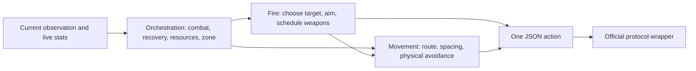

# Current program design and optimization plan

The objective is greedy, aggressive play that earns the highest official
practice score, with a target of **6.0**. Official points are mean `16 - place`
over 48 matches; kills help by eliminating opponents but are not separate points.
The retained best is 4.75. Later aggressive/route experiments scored 4.63 and
4.60. The first-magazine experiment scored 4.58. This controlled experiment
starts from the exact best source `39b6d50` without those changes.

The three agent roles below are development responsibilities and deterministic
controller stages. The competition process is one Python standard-library bot;
it makes no network or model calls during a match.

## Movement strategy agent

Use cube-scaled body dimensions, terrain and solid geometry to choose traversable
ground routes. Keep a bounded incremental route search and short physical motion
rollouts for obstacle, projectile, beam and zone costs. Approach useful range
instead of waiting for enemies to attack first; use the best measured source's
120 m gun and 150 m laser spacing, and its conditional lightning approach.
Reposition for recovery and anticipate the shrinking zone. Validate actual
motion rather than assuming a waypoint is reachable.

The separate fine-route and projected-goal repairs remain documented experiments.
They improved reproduced local failures but did not raise the official aggregate
score in their combined candidate, so they are not bundled into this ablation.

## Fire strategy agent

Proactively rank currently visible threats, favoring useful weakened targets and
recent attackers. Use live weapon statistics, target velocity, firing-time aim
slew and world geometry. Coordinate the two weapons through their shared aim:
gun interception/reloads, laser charge/release, lightning reach and mortar arcs.
Recovery and urgent movement can veto costly charging; continued pressure and
feasible finishing opportunities inform the root controller.

Keep these mechanics exactly at the measured baseline for this experiment.
Candidate changes to urgent quick laser finishing remain separate, unadopted
studies. A private network-delay artifact is not grounds to change official
lockstep aim prediction.

## Orchestration strategy agent

Prioritize zone access, useful combat, recovery and reachable resources using
current observations and live stats. Collect useful cubes and weapons, farm when
conditions permit, and preserve explicit recovery windows. The current isolated
change is to retain a bounded two-second record of last-listed living mechs
when deciding whether a supply drop is contested. Current observations take
precedence; observed kills immediately remove the record. This memory cannot
select targets or authorize fire. Upgrade priorities remain exactly at the 4.75
baseline. See DROP_MEMORY_PLAN.md for the discontinuity evidence, expiry rules
and validation cases.

## Engineering and evaluation

The bot reads `mechfight/1` JSONL observations and flushes valid actions through
the official wrapper. Target a bounded decision below the 50 ms limit, with
one CPU, 512 MB, no network, a read-only image/map and the permitted `/tmp`.
Use a pinned Linux/amd64 Python image and preserve submitted source commits.

For each experiment: state the hypothesis, change one strategic lever, run
meaningful regression and full-map timing checks, then evaluate its exact commit
through official scoring. A private match checks integration and observed actions;
its placement cannot substitute for the coordinated practice score. Keep the
highest accepted entry selected. Do not claim an optimal strategy or a 6.0 result
until the official result establishes it.
